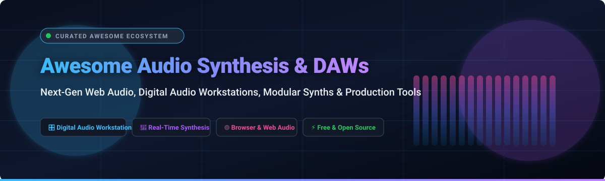

  

# 🎛️ Awesome Audio Synthesis & Digital Audio Workstation (DAW)

  
  
  
  
  

> 🎼 **A curated index of premier SaaS platforms, browser-based DAWs, real-time audio synthesis engines, modular sound generators, and open-source audio production ecosystems.**

---

## 📑 Table of Contents

- [🌟 Overview](#-overview)
- [📊 Sector Overview & Market Dynamics](#-sector-overview--market-dynamics)
- [☁️ SaaS & Hosted Workstations](#️-saas--hosted-workstations)
- [💻 Open-Source GitHub Projects](#-open-source-github-projects)
  - [🎚️ Full Digital Audio Workstations & Studio Suites](#️-full-digital-audio-workstations--studio-suites)
  - [🎹 Audio Synthesis & Modular Sound Engines](#-audio-synthesis--modular-sound-engines)
  - [🌐 Browser Audio Frameworks & Standards](#-browser-audio-frameworks--standards)
- [🤝 How to Contribute](#-how-to-contribute)
- [💖 Support](#-support)
- [📈 Star History](#-star-history)
- [⚠️ Disclaimer](#️-disclaimer)

---

## 🌟 Overview

The modern audio production landscape is undergoing a massive paradigm shift from monolithic, proprietary desktop setups toward accessible, collaborative, cloud-native, and browser-first **Digital Audio Workstations (DAWs)** and **real-time audio synthesis** environments.

This repository catalogs top-tier **SaaS music production platforms** alongside cutting-edge **open-source audio engines**, Web Audio API implementations, modular synthesis frameworks, and live mixing suites. Whether you are an indie music producer seeking free collaborative cloud DAWs or a software developer building real-time DSP pipelines with WebAssembly and Web Audio, this curated guide offers the best resources available.

---

## 📊 Sector Overview & Market Dynamics

The global Digital Audio Workstation (DAW) and audio synthesis software market is estimated at approximately **$4.0B–$4.7B as of 2025–2026**, expanding at a Compound Annual Growth Rate (CAGR) of **~7–9% toward over $6.0B+ by 2031**. 

The sector exhibits **moderate-to-high fragmentation** rather than a winner-take-all monopoly:
- **Desktop Incumbents:** Legacy studio software (Apple Logic Pro, Avid Pro Tools, Ableton Live, Steinberg Cubase) continues to command high-end commercial recording facilities.
- **Enterprise & Consumer Cloud DAWs:** Major media and streaming conglomerates (such as Spotify backing Soundtrap) invest heavily in beginner, education, and podcasting ecosystems.
- **High-Growth Web & Freemium Innovators:** Nimble platforms like BandLab, Amped Studio, and Audiotool capture tens of millions of mobile-first creators with browser-based collaboration and AI assistance.
- **Thriving Open-Source & Standards Ecosystem:** Active FOSS projects (LMMS, Ardour, Surge, Tone.js, openDAW) ensure developers and musicians retain full sovereign control over local-first production, modular sound design, and custom DSP chains.

---

## ☁️ SaaS & Hosted Workstations

The following table provides detailed pricing tiers, strict free plan limits, and corporate scale for leading hosted and browser-based DAW SaaS products, sorted descending by company size:

| Product | Company Size (Valuation / Revenue) | Pricing | Free Tier Limits | Key Highlights |
| :--- | :--- | :--- | :--- | :--- |
| 🎧 **[Soundtrap](https://www.soundtrap.com/)** | **~$120B market cap** *(Parent: Spotify, NYSE: SPOT)* | **$9.59/mo** (Sound Starter, billed annually at $115.08/yr) or $11.99 billed monthly; Music Production at $13.59/mo ($16.99/mo monthly) | **Free Forever Tier**: MP3/OGG exports only (no WAV export), 7,760+ loops, 450+ instruments, 20+ vocal presets, no stem splitter/auto-tune. Paid plans include a **30-day free trial** with full feature access requiring credit card. | Browser collaborative DAW with Spotify integration, classroom education support, and cloud vocal tuning. |
| 🎸 **[BandLab](https://www.bandlab.com/)** | **$425M valuation** *(Series B1 post-money; ~$10M–$48M est. annual revenue)* | **$14.99/mo** or **$99.00/yr** (BandLab Pro Membership); $199.00/yr (BandLab Max) | **Free Forever Tier**: 16 tracks per project max, 20 samples/mo, 5 beats/wk, 436+ instruments, no major streaming service distribution without paid membership. | Social music creation platform with cloud mixdown, built-in stem splitter, SongStarter AI, and 50 collaborators per project. |
| 🎛️ **[Audiotool](https://www.audiotool.com/)** | **~$2.6M total funding** *(Early-stage venture-backed by Unlock Venture Partners)* | **Free / $0/mo** (No paid subscription tiers; 100% free community platform) | **Free Forever Tier (Full Access)**: No track caps, no project length limits, 37 built-in synths/effects, modular cable routing, and real-time multiplayer DAW collaboration with zero paywalls. | Cloud-native modular routing synthesizer and DAW with Web Audio/VST3 bridge and active online musician community. |
| ⚡ **[Amped Studio](https://ampedstudio.com/)** | **Bootstrapped / Private** *(LettoPro SA, Montreux, Switzerland; ~$1M–$3M est. ARR)* | **$5.99/mo** (billed annually at $69.99/yr) or $6.99 billed monthly (Premium); $9.99/mo ($119.99/yr) for Pro | **Free Forever Tier**: Max 16 tracks, MP3-only export (no WAV/project export), 0GB cloud storage, 5 virtual instruments & 10 FX, no external VST3 support, ad-supported. Paid plans offer a **3-day free trial** with full access. | Online DAW featuring remote VST3 plugin hosting via desktop bridge, AI stem splitter, and sample sequencer. |
| 📻 **[AudioSauna](https://chromewebstore.google.com/detail/audiosauna/lkgfemnodkdnenmfkblebnkjpckkjcae)** | **Micro-entity / Inactive** *(Naive Solutions, Helsinki, Finland)* | **Free / $0/mo** (Discontinued legacy web app) | **Free Forever Tier**: Browser session only, 2 synths (analog + 4-op FM Yamaha DX-21 style), 8-track stereo sampler with ping-pong looping, local file saving. *(Note: unmaintained since February 2014).* | Classic web audio synthesizer and sampler with Chrome Web Store deployment; historical precursor to modern web DAWs. |

---

## 💻 Open-Source GitHub Projects

Explore the finest open-source digital audio workstations, synthesis engines, and Web Audio libraries. Repositories are strictly sorted in descending order by GitHub stargazers:

### 🎚️ Full Digital Audio Workstations & Studio Suites

1. **[Tone.js](https://github.com/Tonejs/Tone.js)**   
   **A comprehensive Web Audio framework for making interactive music and synthesizers in the browser.** Provides Web Audio building blocks, polyphonic synthesis, audio routing, transport scheduling, effects chains, and microtiming synchronization.
2. **[LMMS](https://github.com/LMMS/lmms)**   
   **Cross-platform open-source Digital Audio Workstation for music creation.** Features song-editor arrangement, beat/bassline sequencer, piano roll melody editing, full automation tracks, and extensive VST/LADSPA plugin support across Windows, macOS, and Linux.
3. **[Mixxx](https://github.com/mixxxdj/mixxx)**   
   **Free, open-source professional DJ software.** Offers dual or quad decks with BPM detection, automated sync, master tempo key-shifting, vinyl emulation, MIDI/HID controller mappings, and live broadcast capabilities.
4. **[SuperCollider](https://github.com/supercollider/supercollider)**   
   **An audio server, programming language, and IDE for sound synthesis and algorithmic composition.** Industry standard for electroacoustic research, real-time sound processing, live coding, and generative acoustic architecture.
5. **[Ardour](https://github.com/ardour/ardour)**   
   **Professional-grade open-source hard disk recorder and digital audio workstation.** Built for sound engineers, musicians, and soundtrack editors requiring unlimited multi-track recording, non-linear editing, mastering, and full LV2/VST/AU plugin compatibility.
6. **[Bespoke Synth](https://github.com/BespokeSynth/BespokeSynth)**   
   **Node-based modular synthesizer and digital audio workstation.** Built from scratch with patching cords connecting custom synths, step sequencers, sample slicers, and macro controllers in an infinite, freeform creative canvas.
7. **[Surge XT](https://github.com/surge-synthesizer/surge)**   
   **Incredible open-source hybrid synthesizer (VST3, AU, CLAP, LV2, Standalone).** Features 3 oscillators per voice with wavetable, FM, modern unison, ring modulation, flexible dual filter configurations, and deep modulation matrix routing.
8. **[Helio Workstation](https://github.com/helio-fm/helio-workstation)**   
   **Lightweight, distraction-free music composition tool and linear sequencer.** Modern cross-platform linear sequencer with built-in version control (Git-style history), chord suggestions, and seamless desktop/mobile workflow.
9. **[openDAW](https://github.com/andremichelle/openDAW)**   
   **Next-generation web-based DAW with 30+ stock plugins and a roadmap to 1.0 in Q3 2026.** Runs entirely in the browser with no server roundtrip for audio, featuring subtractive synths (Vaporisateur), drum computers (Playfield), WebCLAP plugin hosting, and WASM audio engine processing.
10. **[GridSound](https://github.com/gridsound/daw)**   
    **Work-in-progress free browser-based DAW built directly on the Web Audio API.** Features modular canvas view, real-time audio routing, pattern sequencing, and local cloud saving with clean modern UI aesthetics.
11. **[Csound](https://github.com/csound/csound)**   
    **Time-tested, highly flexible sound and music synthesis system.** Provides hundreds of synthesis opcodes, spectral analysis tools, and language bindings for C, C++, Python, Java, and WebAssembly.
12. **[WAM-Studio](https://github.com/Brotherta/wam-studio)**   
    **Academic open-source DAW implementing W3C standards (Web Audio, Web MIDI, WebAssembly, Web Audio Modules).** Features synchronized multi-track audio/MIDI recording, region editing, FX plugin racks, latency compensation, and browser-native mixing.
13. **[WAVR PRO](https://github.com/oliego-ai/WavrPro)**   
    **Zero-install, client-side browser DAW with local-first data protection.** Features multi-track timeline, 6-band parametric EQ per track, 5 visualizer modes (oscilloscope, spectrum, VU meter), IndexedDB session storage, and standalone single-file distribution (`wavr-pro.html`).

---

## 🤝 How to Contribute

Contributions to this ecosystem list are warmly welcomed! 

1. 🍴 **Fork** this repository.
2. 📝 **Add or update** entries in `README.md` following the established table and star badge formats.
3. 🔍 **Verify details**: Ensure product links, pricing plans, free tier constraints, or GitHub repository links are accurate.
4. 🚀 **Submit a Pull Request** with a descriptive summary of your changes.

---

## 💖 Support

If you find this curated collection useful for your music production or audio development workflow, please consider:
- ⭐ **Starring** the repository on GitHub
- 🍴 **Forking** and contributing new audio tools
- 📢 **Sharing** this repository with producers, audio developers, and synth enthusiasts
- ☕ **Sponsoring the project** to keep it continuously maintained:  
  

Thank you for supporting open audio synthesis and digital audio workstations!

---

## 📈 Star History

---

## ⚠️ Disclaimer

- This is an independent **community-curated** list — inclusion does not constitute commercial endorsement.
- Audio synthesis and DAW experimentation can produce high signal amplitudes; always protect your hearing and monitor at safe levels.
- Free tier quotas, pricing models, and feature packages are subject to change by their respective providers. Please consult official provider documentation for real-time terms.

---

  <b>Made with 🎵 for sound designers, audio software engineers, and digital music creators worldwide.</b>

